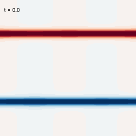

# Spectral Methods in Python

[](https://github.com/ktwyw/spectral-methods-in-python/actions/workflows/notebooks.yml)

Seventeen Jupyter notebooks that teach spectral methods, which for smooth solutions on simple
domains are usually the most accurate way of solving differential equations, through problems
engineering students already
meet in their courses: pipes and ducts, fins, beams and plates, reactors, waves, vibrations and
flow stability. Every exercise has a worked solution, and the last notebook reproduces the
classical critical Rayleigh numbers of convection.



The notebooks follow, with small changes of order, the topics of the classic textbook

> L. N. Trefethen, *Spectral Methods in MATLAB*, SIAM, Philadelphia, 2000.
> [doi:10.1137/1.9780898719598](https://doi.org/10.1137/1.9780898719598)

and are meant to be read beside it. This is an independent companion, not a translation. The
explanations, the engineering examples and the exercises were written for this course, in
Python with NumPy and SciPy, and the repository contains none of the book's text, figures or
exercises. The algorithms are the standard ones, so some code is necessarily close to the
book's: `cheb` keeps the name, the calling convention and the algorithm of the book's `cheb.m`,
the treatment of clamped boundary conditions in notebook 14 is the one of Chapter 14, and a few
classical benchmark problems (the Orr–Sommerfeld eigenvalue, for example) appear in both. The
project is not affiliated with or endorsed by the author or by SIAM. For the theory, the proofs
and the original MATLAB programs, read the book.

What spectral methods give you:

- ten or more correct digits from a few dozen grid points, where finite differences need thousands
- a differentiation matrix in ten lines of code that turns a differential equation into linear algebra
- eigenvalues, stability limits and critical parameters to published accuracy on a laptop
- a clear view of when the method is the wrong tool, which notebook 16 is about

The animation on the right is from notebook 15: the vorticity of a double shear layer, computed
with a solver short enough to read in one sitting.

## The notebooks

Open any notebook in Google Colab with its badge. Nothing needs to be installed.

### Basics

| | Notebook | What it teaches | Engineering examples | Book chapter | |
| --- | --- | --- | --- | --- | --- |
| 1 | [Differentiation matrices](notebooks/01_differentiation_matrices.ipynb) | from finite differences to spectral accuracy | piston velocity and acceleration in a slider-crank mechanism | 1 | [](https://colab.research.google.com/github/ktwyw/spectral-methods-in-python/blob/main/notebooks/01_differentiation_matrices.ipynb) |
| 2 | [Fourier differentiation and the FFT](notebooks/02_fourier_differentiation_and_fft.ipynb) | differentiating in wavenumber space, aliasing, the Nyquist mode, interpolation | the piston again in O(N log N); acceleration from noisy position measurements | 2, 3 | [](https://colab.research.google.com/github/ktwyw/spectral-methods-in-python/blob/main/notebooks/02_fourier_differentiation_and_fft.ipynb) |
| 3 | [Smoothness and spectral accuracy](notebooks/03_smoothness_and_spectral_accuracy.ipynb) | why smooth functions converge fast and how to predict the rate; the Gibbs phenomenon | follower acceleration of two cams, one with dwells and one without | 4 | [](https://colab.research.google.com/github/ktwyw/spectral-methods-in-python/blob/main/notebooks/03_smoothness_and_spectral_accuracy.ipynb) |
| 4 | [Polynomial interpolation and Chebyshev points](notebooks/04_polynomial_interpolation.ipynb) | the Runge phenomenon, barycentric interpolation, Lebesgue constants | a 12-point table of the latent heat of water | 5 | [](https://colab.research.google.com/github/ktwyw/spectral-methods-in-python/blob/main/notebooks/04_polynomial_interpolation.ipynb) |
| 5 | [Chebyshev differentiation matrices](notebooks/05_chebyshev_differentiation_matrices.ipynb) | `cheb(N)`, convergence for four kinds of smoothness, rounding error | heat flux at the base of a cooling fin | 6 | [](https://colab.research.google.com/github/ktwyw/spectral-methods-in-python/blob/main/notebooks/05_chebyshev_differentiation_matrices.ipynb) |

### Advanced

| | Notebook | What it teaches | Engineering examples | Book chapter | |
| --- | --- | --- | --- | --- | --- |
| 6 | [Boundary value problems](notebooks/06_boundary_value_problems.ipynb) | linear, variable-coefficient, nonlinear (Newton) and two-dimensional problems | catalyst effectiveness factor, thermal explosion limit, friction factor of a square duct | 7 | [](https://colab.research.google.com/github/ktwyw/spectral-methods-in-python/blob/main/notebooks/06_boundary_value_problems.ipynb) |
| 7 | [Chebyshev series and the FFT](notebooks/07_chebyshev_series_and_fft.ipynb) | coefficients by cosine transform, reading the resolution off the coefficients, fast differentiation | the Arrhenius rate constant as a short series | 8 | [](https://colab.research.google.com/github/ktwyw/spectral-methods-in-python/blob/main/notebooks/07_chebyshev_series_and_fft.ipynb) |
| 8 | [Eigenvalue problems and pseudospectra](notebooks/08_eigenvalue_problems.ipynb) | which computed eigenvalues to trust, and when eigenvalues mislead | hanging chain, quantum oscillator, square membrane, convection–diffusion | 9 | [](https://colab.research.google.com/github/ktwyw/spectral-methods-in-python/blob/main/notebooks/08_eigenvalue_problems.ipynb) |
| 9 | [Time stepping and stability regions](notebooks/09_time_stepping_and_stability.ipynb) | the method of lines, stability regions, step limits of order N⁻² and N⁻⁴, implicit methods | advection on a ring, cooling of a slab, a pulse on a non-uniform cable | 10 | [](https://colab.research.google.com/github/ktwyw/spectral-methods-in-python/blob/main/notebooks/09_time_stepping_and_stability.ipynb) |
| 10 | [Quadrature](notebooks/10_quadrature.ipynb) | Clenshaw–Curtis and Gauss rules, the periodic trapezoid rule | flow rate and Nusselt number in a tube; flow of a Carreau–Yasuda fluid against a [published value](https://doi.org/10.1016/j.jnnfm.2022.104937) | 12 | [](https://colab.research.google.com/github/ktwyw/spectral-methods-in-python/blob/main/notebooks/10_quadrature.ipynb) |

### Showcase

| | Notebook | What it teaches | Engineering examples | Book chapter | |
| --- | --- | --- | --- | --- | --- |
| 11 | [Nonlinear waves](notebooks/11_nonlinear_waves.ipynb) | integrating factors and exponential time differencing (ETDRK4) | soliton collisions (KdV), a viscous shock (Burgers), chaotic cells (Kuramoto–Sivashinsky) | 10 | [](https://colab.research.google.com/github/ktwyw/spectral-methods-in-python/blob/main/notebooks/11_nonlinear_waves.ipynb) |
| 12 | [Polar coordinates](notebooks/12_polar_coordinates.ipynb) | Chebyshev in radius, Fourier in angle, no trouble at the centre | pipe flow, modes of a drum, cooling of a cylinder, the Graetz problem and Nu = 3.657 | 11 | [](https://colab.research.google.com/github/ktwyw/spectral-methods-in-python/blob/main/notebooks/12_polar_coordinates.ipynb) |
| 13 | [Neumann, Robin and mixed boundary conditions](notebooks/13_boundary_conditions.ipynb) | row replacement, generalized eigenproblems, absorbing ends | fin with a convecting tip, the Heisler-chart problem, a plate with insulated sides, wave reflection | 13 | [](https://colab.research.google.com/github/ktwyw/spectral-methods-in-python/blob/main/notebooks/13_boundary_conditions.ipynb) |
| 14 | [Fourth-order problems](notebooks/14_fourth_order_problems.ipynb) | clamped conditions without spurious modes, the biharmonic operator | beams, buckling, a clamped plate, and Re_c = 5772 for plane Poiseuille flow (Orr–Sommerfeld) | 14 | [](https://colab.research.google.com/github/ktwyw/spectral-methods-in-python/blob/main/notebooks/14_fourth_order_problems.ipynb) |

### Going further

| | Notebook | What it teaches | Engineering examples | Book chapter | |
| --- | --- | --- | --- | --- | --- |
| 15 | [Two-dimensional flow](notebooks/15_two_dimensional_flow.ipynb) | a short pseudo-spectral Navier–Stokes solver, dealiasing, conservation checks | roll-up of a double shear layer, decaying two-dimensional turbulence | beyond the book | [](https://colab.research.google.com/github/ktwyw/spectral-methods-in-python/blob/main/notebooks/15_two_dimensional_flow.ipynb) |
| 16 | [When spectral methods fail](notebooks/16_when_spectral_methods_fail.ipynb) | discontinuities, thin layers, aliasing instability, ill-conditioning, stiffness, corners, bookkeeping mistakes, and the fix for each | eight short failures with their diagnosis, and a guide to choosing a method | beyond the book | [](https://colab.research.google.com/github/ktwyw/spectral-methods-in-python/blob/main/notebooks/16_when_spectral_methods_fail.ipynb) |
| 17 | [Capstone: the onset of Rayleigh–Bénard convection](notebooks/17_capstone_rayleigh_benard.ipynb) | the whole course on one classical problem: Ra_c = 657.5, 1100.65 and 1707.76 | the temperature difference at which a layer of water starts to convect | beyond the book | [](https://colab.research.google.com/github/ktwyw/spectral-methods-in-python/blob/main/notebooks/17_capstone_rayleigh_benard.ipynb) |

Notebooks 1 to 7 should be read in order. After that, pick what matches your course: 8 and 14
for vibrations and stability, 9 and 11 for time-dependent problems, 10, 12 and 13 for transport
phenomena. Notebook 16 is worth reading before you apply the method to a problem of your own.
Notebook 17 assumes notebooks 5, 6, 8, 9, 13 and 14.

## Solutions

Every notebook ends with five exercises. The [`solutions/`](solutions) folder has a notebook of
the same name with a worked solution to each of the 85, and every solution checks its answer
against an independent result.

Try the exercises before opening the solutions. If you teach with this material and would
prefer students not to have them, delete the `solutions/` folder from your copy; nothing else
depends on it.

## How each example is organized

1. **Problem**: stated as it would be in a textbook.
2. **By hand**: the idea or the derivation you are expected to know.
3. **Code**: a few lines of NumPy.
4. **Verify**: an exact solution, a published value, a conservation law or a measured rate of
   convergence, written as an `assert` so that a wrong result stops the notebook.
5. **A plot, and what the result means for an engineer.**
6. **Exercises** at the end of each notebook, with worked solutions in `solutions/`.

A spectral code that is wrong usually still produces a smooth, plausible curve. The habit this
course tries to build is to never accept a number without a check that could have failed.

## The toolbox

[`spectral_tools.py`](spectral_tools.py) collects the core functions the notebooks build and
explain one at a time (`cheb`, `fourier_diff_matrix`, `fft_derivative`, `cheb_coeffs`,
`barycentric_interpolate`, `clenshaw_curtis`, `gauss_legendre` and a few more), with unit tests
in [`tests/`](tests). Each notebook defines the functions it needs itself, so that it runs alone
in Colab; the file is for use in your own work:

```python
import numpy as np
from spectral_tools import cheb

D, x = cheb(20)                      # differentiation matrix and Chebyshev points on [-1, 1]
D2 = (D @ D)[1:-1, 1:-1]             # second derivative acting on functions with u(-1) = u(1) = 0
u = np.linalg.solve(D2, np.cos(3 * x[1:-1]))             # solves u'' = cos(3x)
print(np.abs(u - (np.cos(3) - np.cos(3 * x[1:-1])) / 9).max())   # error at rounding level, about 1e-16
```

## Running the notebooks on your own computer

```bash
git clone https://github.com/ktwyw/spectral-methods-in-python.git
cd spectral-methods-in-python
python -m venv .venv                 # python3 on some systems
source .venv/bin/activate        # Windows: .venv\Scripts\activate
pip install -r requirements.txt
jupyter lab
```

Python 3.11 or newer is required. The notebooks were built with Python 3.13, NumPy 2.5,
SciPy 1.18 and Matplotlib 3.11.

## Testing

The toolbox tests run, and every notebook and every solution is executed from top to bottom, by
[GitHub Actions](.github/workflows/notebooks.yml) on each push to `main`, on each pull request
and on a monthly schedule. To run the same checks locally:

```bash
pip install -r requirements-dev.txt
pytest tests/
pytest --nbmake --nbmake-timeout=600 notebooks/ solutions/
```

Executing notebooks 11 and 15 rewrites the two animations in `notebooks/`. With other versions
of Matplotlib or Pillow the files can differ by a few bytes; `git checkout notebooks/*.gif`
restores the stored copies.

## Where to go next

- L. N. Trefethen, *Spectral Methods in MATLAB* (SIAM, 2000), the book these notebooks accompany
- L. N. Trefethen, *Approximation Theory and Approximation Practice* (SIAM, 2013; extended
  edition 2019), for the theory
  behind notebooks 3, 4 and 7
- J. P. Boyd, *Chebyshev and Fourier Spectral Methods* (2nd ed., Dover, 2001), for a much wider range of
  problems and domains
- C. Canuto, M. Y. Hussaini, A. Quarteroni and T. A. Zang, *Spectral Methods: Fundamentals in
  Single Domains* (Springer, 2006), for the analysis, and its companion volume *Evolution to
  Complex Geometries and Applications to Fluid Dynamics* (Springer, 2007)
- [Chebfun](https://www.chebfun.org/) (MATLAB) and [Dedalus](https://dedalus-project.org/)
  (Python), for production software built on these ideas
- [SymPy for Engineers](https://github.com/ktwyw/sympy-for-engineers), the companion course on
  symbolic computation in the same format

## Feedback

Corrections and suggestions for new examples are welcome through
[issues](https://github.com/ktwyw/spectral-methods-in-python/issues).

## License

[MIT](LICENSE) for the code and text in this repository. Maintained by
[Yanwei Wang](https://github.com/ktwyw), Nazarbayev University.
